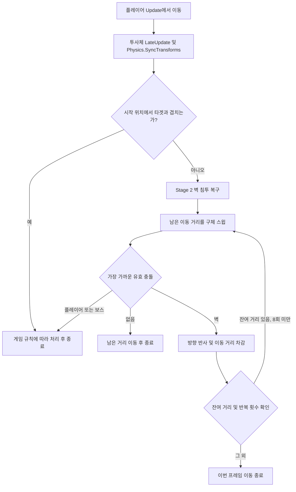
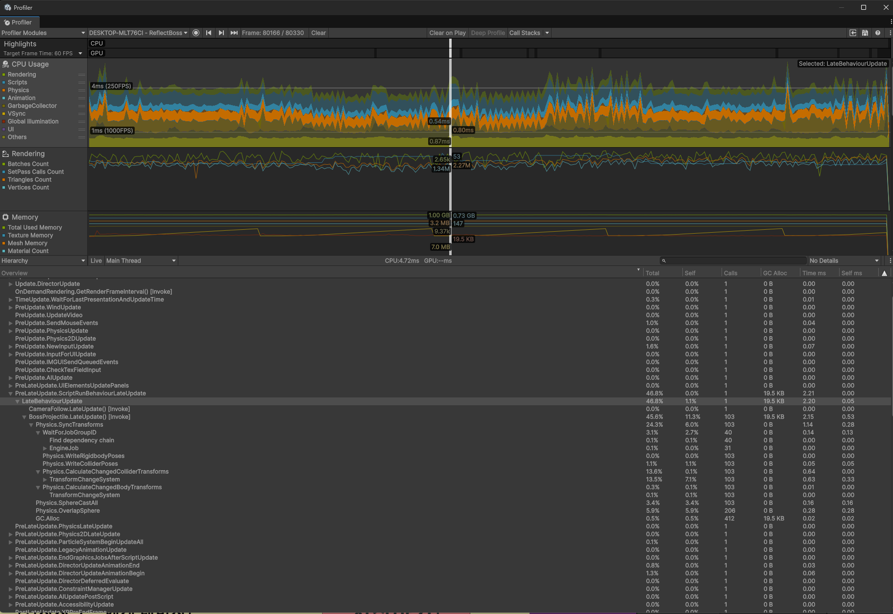
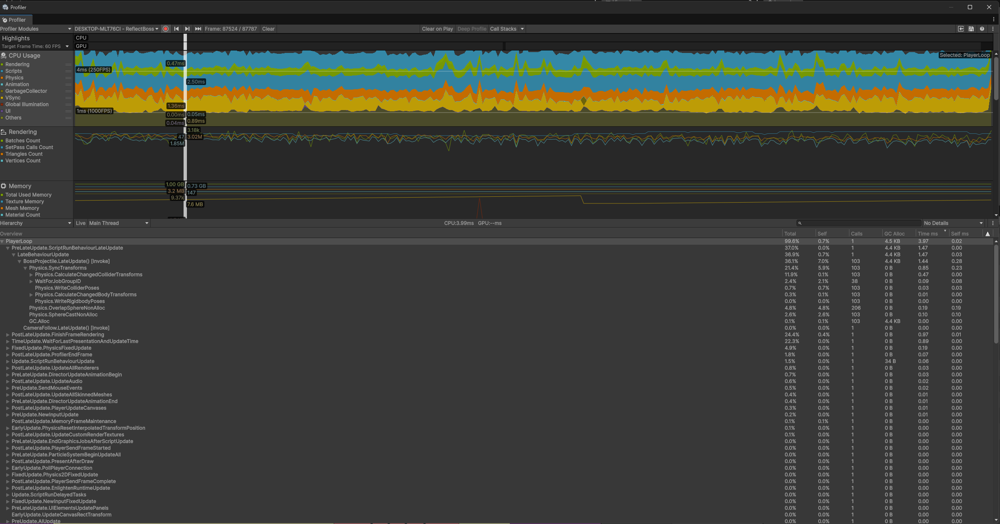

# Reflect Boss

**보스의 공격을 되돌려 보내는 3D 보스전**

Unity 6 · C# · URP · Input System · Windows

[게임 소개](#게임-소개) · [실행 방법](#실행-방법) · [투사체 설계](#투사체-설계) · [성능 개선](#성능-개선) · [코드 안내](#코드-안내) · [제작 과정과 출처](#제작-과정과-출처)

---

하나의 아레나에서 두 종류의 공을 구분하고, **BasketBall을 Block 상태에서 반사해 보스를 쓰러뜨리는** 게임입니다. 보스의 HP가 절반 이하가 되면 3방향 발사와 벽 반사가 추가됩니다.

핵심 구현은 **스윕 기반 이동과 연속 벽 반사**, **반사 주체에 따른 피해 판정**, **물리 쿼리 결과 배열 재사용**입니다. Profiler의 103회 업데이트 선택 프레임 비교에서 투사체 하위 GC 할당량을 **19.5KB → 4.4KB**로 줄였습니다. [측정 기록](docs/PROFILING.md)

<!-- UI·이펙트 수정 후 촬영할 플레이 영상 / GIF / 배포 빌드 링크를 이 위치에 추가합니다. -->

## 게임 소개

### 피할 공과 반사할 공

| 투사체 | 플레이어와 충돌 | 보스와 충돌 |
| :--- | :--- | :--- |
| **Ball** | Block 여부와 관계없이 피해 | 제거되며 피해 없음 |
| **BasketBall** | Block 중이면 보스 방향으로 반사, 그 외에는 피해 | 플레이어가 반사한 경우에만 피해 |

반사는 **우클릭을 유지하는 Block 상태**를 기준으로 판정합니다. Block 중에는 수평 이동이 멈추며, 공중에서도 사용할 수 있습니다.

### 두 단계의 보스전

| | Stage 1 | Stage 2 |
| :--- | :--- | :--- |
| 전환 조건 | 전투 시작 | 보스 HP 50% 이하 |
| 발사 | 플레이어 방향으로 1개 | 중앙과 좌우 30° 방향으로 총 3개 |
| 벽 반사 | 없음 | `Env` 레이어의 벽에서 반사 |

각 탄환은 Ball / BasketBall 중 무작위로 선택됩니다. 벽에서 튕긴 것만으로는 보스에게 피해를 줄 수 없습니다.

### 조작

| 입력 | 동작 |
| :--- | :--- |
| `W` `A` `S` `D` | 카메라 기준 이동 |
| `Left Shift` | 달리기 |
| `Space` | 점프 |
| `마우스 오른쪽 버튼 유지` | Block / BasketBall 반사 |
| 결과 화면의 `Retry` | HP·게임 상태 초기화 후 전투 씬 재시작 |

## 실행 방법

**개발 환경:** Unity **6000.2.15f1**, C#, URP **17.2.0**, Input System **1.16.0**.

에디터에서는 [`LoadingScene`](Assets/@Scenes/LoadingScene.unity)에서 시작합니다. 이 씬에서 리소스·설정·HP를 초기화한 뒤 `DevScene`으로 진입합니다.

## 투사체 설계

핵심 코드: [`BossProjectile.cs`](Assets/@Scripts/Controllers/BossProjectile.cs)

### 이동 경로를 검사하는 방식

투사체는 `speed × deltaTime`으로 이동 거리를 계산하고, **Unity Physics의 구체 스윕 쿼리**로 경로상의 충돌을 검사합니다. Rigidbody의 동적 이동 대신 코드에서 이동 거리와 충돌 후 반응을 제어합니다.

프레임 내 처리 흐름

- **초기 겹침:** 스윕 전에 `OverlapSphereNonAlloc`으로 타겟 겹침을 확인합니다. Stage 2의 벽 침투는 `ComputePenetration`의 분리 방향과 깊이로 복구합니다.
- **연속 벽 반사:** 충돌점까지 이동한 거리를 차감하고 남은 거리를 다시 검사합니다. 반복은 최대 8회이며, 제한에 도달하면 그 프레임의 잔여 이동을 중단합니다.
- **실행 순서:** 플레이어가 `Update`에서 이동한 뒤 투사체가 `LateUpdate`에서 동기화하고 쿼리합니다. 현재 동기화는 투사체마다 수행합니다.

### 벽 반사와 플레이어 반사의 구분

`IsReflected`는 **플레이어가 BasketBall을 반사했을 때만** 설정됩니다. 벽 반사는 진행 방향만 바꿉니다. 보스 피격 시 투사체 종류와 이 상태를 함께 검사해 피해 여부를 결정합니다.

`_hasLeftBoss`는 발사 직후 보스와의 겹침을 구분하고, `_finished`와 콜라이더 비활성화는 제거 시 중복 처리를 방지합니다.

## 성능 개선

### 관찰 → 판단 → 변경

Stage 2 후반에서 투사체 수와 함께 `BossProjectile.LateUpdate` 하위의 GC 할당량이 증가했습니다. 매 프레임 결과 배열을 반환하는 물리 쿼리를 개선 대상으로 선택하고, 전투 규칙을 유지한 채 **쿼리 결과 배열 재사용**을 적용했습니다.

| 변경 전 | 변경 후 |
| :--- | :--- |
| 겹침 검사마다 `OverlapSphere` 결과 배열 반환 | `OverlapSphereNonAlloc`과 재사용 `Collider[]` |
| 스윕마다 `SphereCastAll` 결과 배열 반환 | `SphereCastNonAlloc`과 재사용 `RaycastHit[]` |

투사체별 버퍼는 각각 16칸에서 시작하며, 반환된 결과 개수까지만 순회합니다. 버퍼가 가득 차면 충돌 누락을 방지하기 위해 **두 배로 확장하고 재조회**합니다. 결과 순서에 의존하지 않고 가장 가까운 유효 충돌을 선택합니다.

### 선택 프레임 비교

Windows Player에서 수집한 **`BossProjectile.LateUpdate`와 하위 호출의 합계**입니다. Calls는 선택 프레임의 업데이트 호출 수입니다.

| 상황 | Calls 전 → 후 | GC Alloc 전 → 후 | 처리 시간 전 → 후 |
| :--- | :---: | :---: | :---: |
| Stage 1 일반 플레이 | 4 → 4 | 약 0.7KB → **176B** | 0.10 → 0.08ms |
| Stage 2 중간 부하 | 60 → 61 | 11.4KB → **2.6KB** | 1.01 → 0.87ms |
| Stage 2 후반 고부하 | 103 → 103 | 19.5KB → **4.4KB** | 2.15 → 1.44ms |

**103회 처리 프레임에서 표시값 기준 약 77%의 할당 감소**를 관측했습니다. 단일 프레임 비교이며, 탄환 배치와 실행 환경이 완전히 동일하지 않아 CPU 시간은 참고값으로 제시합니다. 평균 FPS 개선이나 GC 지연 해소를 입증한 결과는 아닙니다.

<strong>103회 처리 — Before / After 원본 캡처 보기</strong>

**Before · Frame 80166 · 19.5KB**

**After · Frame 87524 · 4.4KB**

초기 배열 생성·확장과 다른 경로의 할당은 남습니다. 측정 조건, 전체 캡처와 검증 범위는 [성능 측정 기록](docs/PROFILING.md)에 정리했습니다.

## 코드 안내

| 역할 | 코드 | 확인할 내용 |
| :--- | :--- | :--- |
| 투사체 | [`BossProjectile`](Assets/@Scripts/Controllers/BossProjectile.cs) | 이동·스윕·반사 상태·배열 재사용 |
| 플레이어 | [`Player`](Assets/@Scripts/Controllers/Creature/Player.cs) | CharacterController, 카메라 기준 이동, 개별 InputActionMap, 상태별 애니메이션 |
| 보스 | [`Boss`](Assets/@Scripts/Controllers/Creature/Boss.cs) | 발사 주기, HP에 따른 단계 전환, 3방향 발사 |
| 카메라 | [`CameraFollow`](Assets/@Scripts/Controllers/CameraFollow.cs) | LateUpdate의 SmoothDamp 위치 추적 |
| HUD | [`UI_GameScene`](Assets/@Scripts/UI/Scene/UI_GameScene.cs) | HP 표시 보간, 단계 표시, 결과 팝업 |
| 재시작 | [`SceneManager`](Assets/@Scripts/Managers/SceneManager.cs) | 시간 배율 복구·상태 초기화·씬 재로드 |
| 리소스 | [`ResourceManager`](Assets/@Scripts/Managers/ResourceManager.cs) | Resources 기반 로딩 및 IResourceLoader 인터페이스 |

게임 상태와 HP 변경은 `EventManager`를 통해 UI에 전달합니다. 리소스는 현재 `Resources.LoadAll`로 동기 로딩하며, 투사체 생성·제거는 `Instantiate` / `Destroy`를 사용합니다.

## 제작 과정과 출처

| 구분 | 활용 내용 |
| :--- | :--- |
| 학습 기반 | 인프런 Rookiss의 Unity Framework 강의를 수강하며 구축한 프레임워크를 프로젝트에 맞게 수정했습니다. |
| 배경 | 무료 에셋 **BasketBall stadium Environment** 사용 |
| 캐릭터 | **Tripo**를 이용해 생성 |
| 코드 작성·검토 | **AI 에이전트**를 전투 코드 작성, 검토 및 배열 재사용 변경에 활용 |

구현 과정에서 AI 에이전트를 적극 활용했으며, 설계 방향과 수정 사항은 직접 판단하고 코드 검토와 동작 확인을 진행했습니다.

## 알려진 한계

- Stage 2 탄환에는 시간 기반 제거 제한이 없어 장기 생존 시 누적될 수 있습니다.
- 투사체별 `SyncTransforms` 호출은 유지했습니다. 통합 시 이동 순서와 쿼리 시점 검증이 필요합니다.
- 저프레임·고속·이동 장애물 조건의 충돌 정확성은 추가 검증 대상입니다.
