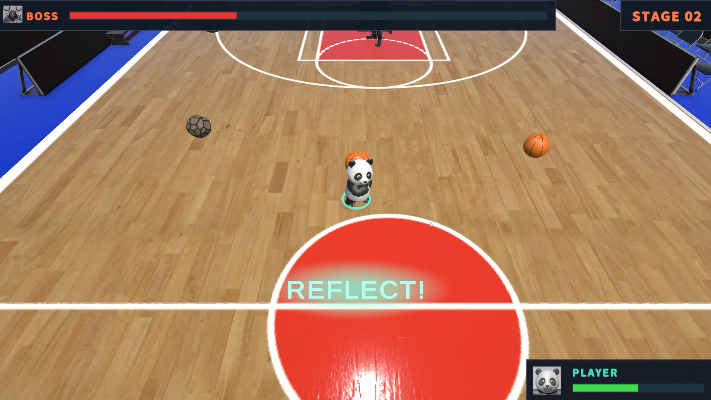
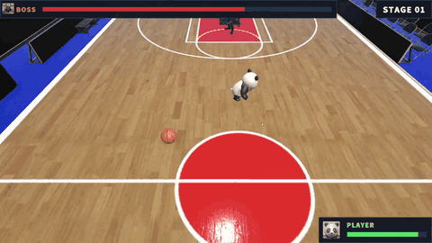
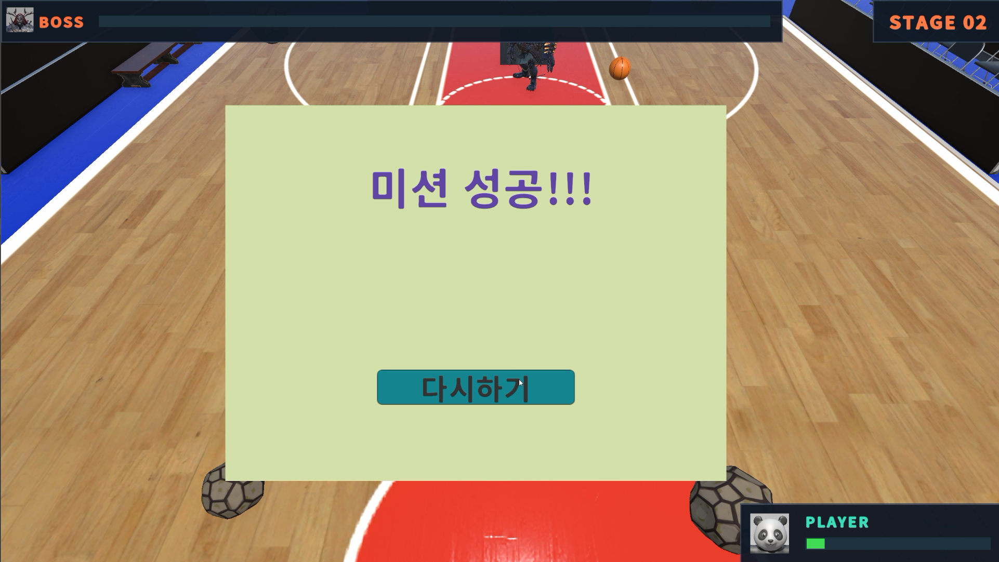

# Reflect Boss

**피할 공은 피하고, 반사할 공은 보스에게 돌려보내는 3D 보스전**

Unity 6 · C# · URP · Input System · Windows

[플레이 영상](docs/media/gameplay.mp4) · [게임 소개](#게임-소개) · [주요 구현](#주요-구현) · [성능 개선](#성능-개선)

농구장을 배경으로 두 종류의 투사체를 구분하고, **농구공을 반사해 보스를 쓰러뜨리는** 게임입니다. 보스의 체력이 절반 이하가 되면 3방향 발사와 벽 반사가 추가됩니다.

**[전체 플레이 영상 보기 / 다운로드 — 1분 43초, MP4](docs/media/gameplay.mp4)**

짧은 플레이 미리보기와 성공 화면

**플레이 영상 일부 · GIF**

**보스 처치 후 성공 화면**

## 게임 소개

### 피할 공과 반사할 공

| 투사체 | 대응 방법 | 보스에게 피해를 주는 조건 |
| :--- | :--- | :--- |
| **Ball · 돌 모양 공** | 회피 — Block 중에도 피격 | 피해를 주지 않음 |
| **BasketBall · 농구공** | Block 상태에서 보스 방향으로 반사 | 플레이어가 반사한 공이 보스와 충돌 |

반사는 **우클릭을 유지하는 Block 상태**를 기준으로 판정합니다. Block 중에는 수평 이동이 멈추므로, 회피와 반사 사이에서 행동을 선택해야 합니다. 벽에서 튕긴 공은 그것만으로 보스에게 피해를 주지 않습니다.

| | Stage 1 | Stage 2 |
| :--- | :--- | :--- |
| 진입 조건 | 전투 시작 | 보스 HP 50% 이하 |
| 발사 패턴 | 플레이어 방향으로 1개 | 중앙·좌우 30° 방향으로 3개 |
| 벽 충돌 | 벽 반사 없음 | 벽에서 반사하며 이동 지속 |

### 조작

| 입력 | 동작 |
| :--- | :--- |
| `W` `A` `S` `D` | 카메라 기준 이동 |
| `Left Shift` | 달리기 |
| `Space` | 점프 |
| `마우스 오른쪽 버튼 유지` | Block / 농구공 반사 |
| 결과 화면의 `다시하기` | 체력·게임 상태 초기화 후 재시작 |

## 주요 구현

### 캐릭터 조작과 보스전 흐름

- **플레이어:** `CharacterController` 기반 이동·점프와 Idle / Walk / Run / Jump / Block 상태를 연결했습니다. InputActionMap을 복제해 플레이어 입력을 UI 입력과 분리하고, 상태에 따라 애니메이션을 전환합니다.
- **카메라:** `LateUpdate`에서 `SmoothDamp`로 플레이어 위치를 추적합니다. 카메라 회전을 고정해 카메라 기준 이동 방향이 안정적으로 유지되도록 했습니다.
- **보스와 재시작:** 체력에 따라 공격 패턴을 전환하고, 승리·실패 시 결과 팝업을 표시합니다. 다시하기에서는 시간 배율·체력·게임 상태를 복구하고 전투 씬을 다시 로드합니다.

코드: [Player](Assets/@Scripts/Controllers/Creature/Player.cs) · [CameraFollow](Assets/@Scripts/Controllers/CameraFollow.cs) · [Boss](Assets/@Scripts/Controllers/Creature/Boss.cs) · [SceneManager](Assets/@Scripts/Managers/SceneManager.cs)

### 스윕 기반 투사체 이동과 반사 판정

투사체는 Rigidbody의 동적 이동 대신 **Unity Physics 쿼리로 이동 경로를 검사하고, 충돌 이후의 이동을 코드에서 제어**합니다.

1. 플레이어의 `Update` 이동 이후, 투사체의 `LateUpdate`에서 `Physics.SyncTransforms()`를 호출합니다.
2. `OverlapSphereNonAlloc`으로 시작 위치의 타겟 겹침을 검사합니다. Stage 2에서는 `ComputePenetration`으로 벽 침투를 복구합니다.
3. `SphereCastNonAlloc`으로 이번 프레임의 이동 경로를 검사하고, 가장 가까운 유효 충돌을 선택합니다.
4. 벽에 닿으면 방향을 반사하고 남은 이동 거리로 다시 검사합니다. 한 프레임의 반복은 최대 8회로 제한합니다.

**벽 반사와 플레이어 반사는 서로 다른 의미로 처리합니다.** `IsReflected`는 플레이어가 농구공을 반사했을 때만 설정하며, 보스 피해는 투사체 종류와 이 상태를 함께 확인합니다. 제거가 결정된 투사체는 `_finished`와 콜라이더 비활성화로 중복 처리를 막습니다.

코드: [BossProjectile](Assets/@Scripts/Controllers/BossProjectile.cs)

### 판정과 분리한 UI·시각·사운드 피드백

- **반사 성공:** 기존 `ReflectSuccess` 이벤트를 받아 `REFLECT!` 문구와 짧은 UI Glow, 플레이어 발밑의 링을 재생합니다. 링은 `LineRenderer`를 재사용하며, 연속 반사 시 이전 연출을 중단하고 다시 시작합니다.
- **체력과 단계 표시:** 남은 체력 비율을 보간해 표시하고, 피격 시 짧게 밝아집니다. Boss HP는 화면 상단에 길게, Player HP는 오른쪽 아래에 배치했습니다. Stage 변경은 색상과 작은 확대 효과로 알립니다.
- **사운드:** 반사·플레이어 충돌·보스 피격에 기존 `SoundManager.Play2D()` 경로로 효과음을 연결했습니다.

UI와 링은 반사 여부를 매 프레임 검사하지 않고, **확정된 이벤트를 수신할 때 연출을 시작**합니다. 투사체의 충돌 판정과 표현 코드를 분리했습니다.

코드: [UI_GameScene](Assets/@Scripts/UI/Scene/UI_GameScene.cs) · [ReflectFeedback](Assets/@Scripts/UI/Scene/ReflectFeedback.cs) · [PlayerReflectFeedback](Assets/@Scripts/Controllers/PlayerReflectFeedback.cs) · [SoundManager](Assets/@Scripts/Managers/SoundManager.cs)

## 성능 개선

Stage 2 후반에서 투사체 업데이트 수와 함께 증가하는 GC 할당을 관찰하고, **물리 쿼리 결과 배열 재사용**으로 개선 범위를 좁혔습니다.

`OverlapSphere` / `SphereCastAll`을 NonAlloc 쿼리로 교체했습니다. 투사체마다 결과 배열을 보관하고 반환 개수만 순회하며, 버퍼가 가득 차면 **두 배로 확장한 뒤 재조회**해 결과 누락에 대비합니다.

Windows Player에서 수집한 `BossProjectile.LateUpdate` 및 하위 호출의 **선택 프레임** 비교입니다.

| 상황 | 업데이트 호출 수 전 → 후 | GC Alloc 전 → 후 |
| :--- | :---: | :---: |
| Stage 1 일반 플레이 | 4 → 4 | 약 0.7KB → **176B** |
| Stage 2 중간 부하 | 60 → 61 | 11.4KB → **2.6KB** |
| Stage 2 후반 고부하 | 103 → 103 | 19.5KB → **4.4KB** |

103회 처리 프레임에서 표시값 기준 **약 77%의 할당 감소**를 관측했습니다. 이는 배열 재사용 변경 당시의 자료로, 이후 추가한 UI·연출을 포함한 게임 전체의 할당량이 아닙니다. 단일 프레임 비교이며 실행 조건에 차이가 있으므로 평균 FPS 향상이나 끊김 해소를 입증한 결과로 해석하지 않습니다.

측정 조건, 변경 전후 캡처, CPU 시간과 검증 범위는 **[성능 측정 기록](docs/PROFILING.md)**에 정리했습니다.

## 개발 환경과 실행

**Unity 6000.2.15f1 · URP 17.2.0 · Input System 1.16.0**

소스에서 실행할 때는 [`LoadingScene`](Assets/@Scenes/LoadingScene.unity)을 시작점으로 사용합니다. 리소스와 게임 상태를 초기화한 뒤 전투 씬으로 진입합니다.

## 제작 과정과 출처

| 구분 | 활용 내용 |
| :--- | :--- |
| 학습 기반 | 인프런 **Rookiss의 Unity Framework 강의**를 수강하며 만든 프레임워크를 프로젝트에 맞게 수정 |
| 배경 | 무료 에셋 **BasketBall stadium Environment** 사용 |
| 캐릭터 | **Tripo**를 이용해 생성 |

구현 과정에서 AI 에이전트를 적극 활용했으며, 설계 방향과 수정 사항은 직접 판단하고 코드 검토와 동작 확인을 진행했습니다.
